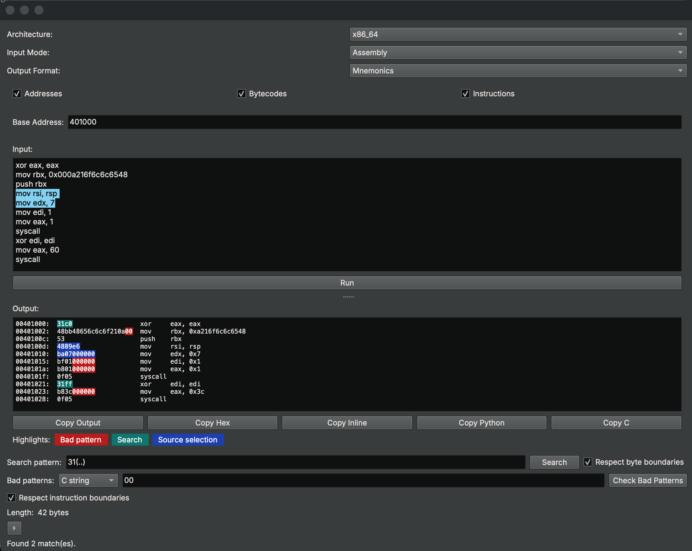

# Shellcoder

  Assemble, inspect, and format shellcode without leaving Binary Ninja.

  

## Use

  Open `Plugins > Shellcoder`, then:

- Choose `Auto`, `Assembly`, or `Hex` input.
- Set the architecture and optional base address.
- Select Inline, Hex, Python, C array, or mnemonic output.
- Copy the current output, or copy a specific format directly.

## Inspect

- Select an input line to highlight its output bytes.
- Select output bytes to jump back to their source line.
- Search hex with regular expressions.
- `Respect byte boundaries` excludes partial-byte matches.
- Check bad patterns, optionally requiring a match to stay within one decoded instruction.
- Built-in presets cover C strings, line breaks, and whitespace.

## Notes

- Comments starting with `#`, `;`, or `//` are accepted.
- Requires Binary Ninja 4526 or newer.
- Binary Ninja provides the runtime dependencies.

## Development

```sh
uv run python -m unittest discover -s tests
```

## License

[Apache-2.0](LICENSE)
